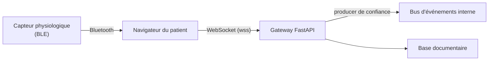

# Authentifier un WebSocket Navigateur : le JWT dans `Sec-WebSocket-Protocol`

*Un endpoint WebSocket d'ingestion de capteurs qui commence par `await websocket.accept()` sans rien vérifier : la faille est banale, et sur une plateforme de santé elle permet d'écrire de faux biosignaux dans n'importe quel dossier patient. La corriger oblige à contourner une limite peu connue de l'API WebSocket des navigateurs.*

---

## 🩺 Le Contexte

L'architecture est classique pour de l'IoT grand public :



Le capteur ne parle qu'au navigateur. Le navigateur regroupe les mesures (fréquence cardiaque, SpO₂, activité électrodermale, détection de chute…) et les envoie en JSON sur un WebSocket. Le backend est le seul producteur autorisé vers le bus interne, qui n'est jamais exposé.

Le maillon faible était le WebSocket lui-même :

```python
@router.websocket("/ws/sensor")
async def ingest(websocket: WebSocket):
    await websocket.accept()          # n'importe qui
    while True:
        data = await websocket.receive_json()
        store(data)                   # avec n'importe quel patient_id
```

Pas de token, pas d'identité, et le `patient_id` est lu tel quel dans le message. Quiconque connaît l'URL publique peut injecter des mesures sous l'identifiant de son choix, ou saturer le stockage.

---

## 🚧 Le Problème : pas de header `Authorization`

Sur une route HTTP, on enverrait `Authorization: Bearer <jwt>`. Mais le constructeur WebSocket du navigateur n'accepte que deux paramètres :

```js
new WebSocket(url)
new WebSocket(url, protocols)   // et c'est tout : aucun moyen de poser un header
```

Trois options s'offrent alors :

| Option | Problème |
| :--- | :--- |
| `wss://…/ws/sensor?token=eyJ…` | L'URL complète atterrit dans les **access logs** du reverse proxy, l'historique, parfois l'APM. Un jeton médical en clair dans des fichiers texte. |
| Cookie de session | Envoyé automatiquement, mais fragile entre domaines (gateway ≠ portail) et expose au **CSWSH** (*Cross-Site WebSocket Hijacking*) si l'`Origin` n'est pas vérifiée. |
| **Sous-protocole** | C'est un header, non journalisé par défaut, et explicitement posé par le client. |

---

## 🔑 La Solution : détourner `Sec-WebSocket-Protocol`

Le second paramètre du constructeur alimente le header de handshake `Sec-WebSocket-Protocol`. Il est prévu pour négocier un format de messages (`mqtt`, `graphql-ws`…), mais rien n'interdit d'y glisser une valeur supplémentaire. Kubernetes procède exactement ainsi pour `exec` depuis un navigateur.

Côté client :

```js
export const IOT_WS_SUBPROTOCOL = 'app.iot.v1';

export function iotWsProtocols(token) {
  return token ? [IOT_WS_SUBPROTOCOL, `bearer.${token}`] : [IOT_WS_SUBPROTOCOL];
}

const ws = new WebSocket(serverUrl, iotWsProtocols(accessToken));
```

Un JWT est composé de base64url et de points : ce sont des caractères autorisés dans un *token* au sens de la RFC 6455, il passe donc sans encodage.

Le handshake ressemble alors à ceci :

```
GET /ws/sensor HTTP/1.1
Upgrade: websocket
Sec-WebSocket-Protocol: app.iot.v1, bearer.eyJhbGciOi…

HTTP/1.1 101 Switching Protocols
Sec-WebSocket-Protocol: app.iot.v1
```

> ⚠️ **Règle d'or** : le serveur doit renvoyer **une** des valeurs proposées, sinon le navigateur ferme la connexion. Il renvoie le sous-protocole applicatif, **jamais** `bearer.…` : le token ne fait pas l'aller-retour.

---

## 🛡️ Côté Serveur : réutiliser la validation existante

La tentation est d'écrire un second validateur JWT « spécial WebSocket ». C'est une mauvaise idée : deux implémentations, deux surfaces d'audit, deux façons de diverger. Le helper se contente d'**extraire** le token, puis délègue au validateur déjà utilisé par les routes HTTP.

```python
WS_IOT_SUBPROTOCOL = "app.iot.v1"
WS_BEARER_PREFIX = "bearer."
WS_CLOSE_UNAUTHORIZED = 4401
WS_CLOSE_TRY_AGAIN_LATER = 1013


def extract_ws_subprotocols(websocket: WebSocket) -> tuple[list[str], str | None]:
    raw = websocket.headers.get("sec-websocket-protocol", "")
    offered, token = [], None
    for item in (p.strip() for p in raw.split(",")):
        if item.startswith(WS_BEARER_PREFIX):
            token = item[len(WS_BEARER_PREFIX):] or None
        elif item:
            offered.append(item)
    return offered, token


async def authenticate_websocket(websocket: WebSocket) -> WsIdentity | None:
    offered, token = extract_ws_subprotocols(websocket)
    subprotocol = WS_IOT_SUBPROTOCOL if WS_IOT_SUBPROTOCOL in offered else None

    if not token:
        await _reject(websocket, subprotocol, WS_CLOSE_UNAUTHORIZED, "Missing token")
        return None
    try:
        creds = HTTPAuthorizationCredentials(scheme="Bearer", credentials=token)
        payload = await validate_bearer_token(websocket, creds, get_oidc_config())
    except HTTPException as e:
        code = WS_CLOSE_TRY_AGAIN_LATER if e.status_code == 503 else WS_CLOSE_UNAUTHORIZED
        await _reject(websocket, subprotocol, code, "Unauthorized")
        return None

    await websocket.accept(subprotocol=subprotocol)
    return WsIdentity(patient_id=payload.app_user_id or payload.sub, subject=payload.sub)
```

Un détail qui compte : pour transmettre un **close code**, il faut d'abord accepter la connexion, puis la fermer aussitôt. Refuser avant l'`accept()` produit un HTTP 403 opaque, et le client ne peut pas distinguer « token expiré » de « serveur en panne ». Entre les deux, aucun message n'est lu.

```python
async def _reject(websocket, subprotocol, code, reason):
    await websocket.accept(subprotocol=subprotocol)
    await websocket.close(code=code, reason=reason)
```

### Ce que fait le validateur partagé

Il gère deux familles de tokens, routées par le champ `alg` du header (lu **sans** vérification, uniquement pour choisir le chemin) :

- **HS256** : token émis par l'application elle-même, signature HMAC vérifiée avec le secret applicatif, `exp` et `sub` obligatoires.
- **RS256** : token émis par le fournisseur OIDC. Clés publiques récupérées via le JWKS (en cache), clé choisie par `kid`, signature RSA vérifiée, `exp`, `sub` et **`iss`** contrôlés.

Ce routage par `alg` est la porte d'entrée classique de l'*algorithm confusion*. Je l'ai donc testé contre le vrai code avec une paire RSA jetable :

| Attaque | Résultat |
| :--- | :--- |
| `alg: none` (pas de signature) | ❌ rejeté |
| `alg: HS256` signé avec la clé publique RSA | ❌ rejeté |
| `alg: HS512` sur le chemin RSA | ❌ rejeté |
| RS256 valide mais `iss` d'un autre realm | ❌ rejeté |
| RS256 valide | ✅ accepté |

Annoncer `HS256` mène à la vérification par le **secret**, inconnu de l'attaquant. Annoncer autre chose mène aux **clés RSA**, que la bibliothèque (Authlib) refuse d'employer pour un HMAC. C'est aussi pour cette raison que la stack a quitté `python-jose` (CVE-2024-33663).

---

## 🔍 Authentifier ne suffit pas : autoriser chaque message

Un patient authentifié reste capable d'écrire `{"patient_id": "quelqu-un-d-autre"}`. L'identité extraite du token doit donc être confrontée **à chaque message**.

Plutôt que de modifier les handlers d'ingestion existants (sliding windows, workers, producteurs…), on leur passe un **proxy** du WebSocket qui filtre les lectures :

```python
class IngestionWebSocket:
    def __init__(self, websocket, identity, *, rate_per_second=50.0, burst=100,
                 max_bytes=256 * 1024):
        self._ws = websocket
        self.identity = identity
        self._bucket = TokenBucket(rate_per_second, burst)
        self._max_bytes = max_bytes

    def __getattr__(self, name):          # tout le reste est délégué
        return getattr(self._ws, name)

    async def _violation(self, code, reason):
        await self._ws.close(code=code, reason=reason)
        raise WebSocketDisconnect(code=code, reason=reason)

    async def _check(self, message: str) -> dict:
        if len(message.encode()) > self._max_bytes:
            await self._violation(1009, "Message too big")
        if not self._bucket.allow():
            await self._violation(1008, "Rate limit exceeded")
        try:
            data = json.loads(message)
        except json.JSONDecodeError:
            await self._violation(1008, "Invalid JSON")
        if not isinstance(data, dict):
            await self._violation(1008, "Payload must be a JSON object")
        pid = data.get("patient_id")
        if pid is None or str(pid) != self.identity.patient_id:
            await self._violation(1008, "patient_id mismatch")
        return data

    async def receive_text(self) -> str:
        message = await self._ws.receive_text()
        await self._check(message)
        return message

    async def receive_json(self):
        return await self._check(await self._ws.receive_text())
```

Lever `WebSocketDisconnect` est le point clé : les handlers existants savent déjà traiter une déconnexion client. La violation emprunte donc un chemin éprouvé, sans une ligne modifiée dans la logique d'ingestion.

L'endpoint devient :

```python
@router.websocket("/ws/sensor")
async def ingest(websocket: WebSocket):
    identity = await authenticate_websocket(websocket)
    if identity is None:
        return
    await backend.handle_client(IngestionWebSocket(websocket, identity))
```

### Le rate-limit : un token bucket, pas plus

Les bibliothèques de rate-limit HTTP raisonnent en requêtes. Sur un WebSocket, il n'y a qu'**une** requête suivie d'un flux. Un seau à jetons par connexion suffit largement :

```python
class TokenBucket:
    def __init__(self, rate: float, burst: int):
        self.rate, self.capacity = rate, float(burst)
        self.tokens, self.updated = float(burst), time.monotonic()

    def allow(self) -> bool:
        now = time.monotonic()
        self.tokens = min(self.capacity, self.tokens + (now - self.updated) * self.rate)
        self.updated = now
        if self.tokens >= 1:
            self.tokens -= 1
            return True
        return False
```

Le seau se remplit de 50 jetons par seconde et en contient au maximum 100. Il absorbe les rafales, coupe un flux soutenu, et reste très au-dessus du débit légitime (une dizaine de lots par seconde).

---

## 📟 Des Close Codes qui Disent Quelque Chose

| Code | Signification | Moment | Réaction attendue du client |
| :--- | :--- | :--- | :--- |
| **4401** | Non authentifié (plage applicative 4000–4999) | Handshake | Rafraîchir le token, se reconnecter |
| **1013** | *Try Again Later* : fournisseur OIDC indisponible | Handshake | Backoff puis reconnexion |
| **1008** | *Policy Violation* : identité, format, débit | Message | Ne pas rejouer : bug ou attaque |
| **1009** | *Message Too Big* | Message | Réduire la taille des lots |

Un client qui reçoit 4401 sait qu'il doit renouveler son token. Un client qui reçoit 1006 (fermeture anormale, sans code) ne sait rien.

---

## 🧾 Traçabilité

Les événements de connexion portent désormais l'identité authentifiée (`patient_id`, `sub`, type d'utilisateur) en plus de l'IP, et chaque refus produit un événement `ws_rejected`. Le token, lui, n'est **jamais** journalisé, ni à l'acceptation ni au refus.

---

## 🧪 Tester sans infrastructure

Le chemin HS256 permet de signer de vrais tokens dans les tests, sans fournisseur OIDC ni base de données :

```python
def test_other_patient_payload_rejected():
    token = encode_hs256_token({"sub": "patient-b"}, expires_in_seconds=300)
    protocols = ["app.iot.v1", f"bearer.{token}"]
    with TestClient(app).websocket_connect("/ws", subprotocols=protocols) as ws:
        ws.send_text(json.dumps({"patient_id": "patient-a"}))
        with pytest.raises(WebSocketDisconnect) as exc:
            ws.receive_json()
    assert exc.value.code == 1008
```

Cinq cas suffisent à verrouiller le comportement : sans token (4401), token invalide (4401), token valide accepté et **non renvoyé** dans le sous-protocole, `patient_id` d'un autre (1008), débit dépassé (1008).

---

## ⚖️ Limites Assumées

- **Vérification au handshake uniquement** : une connexion ouverte survit à l'expiration du token. La reconnexion revalide. Pour aller plus loin, il faudrait fermer la connexion à `exp`.
- **Audience non contrôlée** : tout token valide du realm passe. Exiger `azp` = client du portail patient resserrerait le périmètre.
- **Refresh token HS256** : sans contrôle d'un claim `type`, un refresh token serait accepté comme un access token.
- **Données fabriquées par leur propriétaire** : un patient peut toujours envoyer de fausses mesures *sous sa propre identité*. Seule une signature côté capteur l'empêcherait.
- **Reverse proxy** : `Sec-WebSocket-Protocol` traverse nginx sans configuration particulière (`Upgrade` / `Connection` suffisent), mais un WAF ou un CDN peut le filtrer. À vérifier en conditions réelles.

---

## 🎯 Synthèse

| Approche | Exposition du token | Autorisation | Verdict |
| :--- | :--- | :--- | :--- |
| Aucun contrôle | — | Aucune | Injection triviale |
| Token en query string | Logs proxy, historique | Selon implémentation | Fuite garantie |
| Cookie | Faible | Oui | Risque CSWSH, fragile cross-domain |
| **Sous-protocole + validateur partagé + proxy par message** | **Header non journalisé, non renvoyé** | **Identité ↔ `patient_id` à chaque message** | **Cible** |

La leçon tient en deux phrases. Un WebSocket est une route comme une autre et mérite le même validateur que le reste de l'API, pas un validateur à part. Et l'authentification au handshake ne dispense pas d'autoriser **chaque message** : c'est le message, pas la connexion, qui écrit dans le dossier patient.
