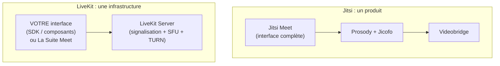

# Jitsi ou LiveKit : produit fini ou infrastructure ? Choisir une visio auto-hébergée

*En auto-hébergeant la visio d'une plateforme de télésanté, la question est vite arrivée : pourquoi Jitsi, alors que l'État a construit sa propre visio (La Suite Meet) sur LiveKit ? La réponse tient en une distinction que les comparatifs oublient souvent.*

> Cet article est une **analyse de décision**, pas un retour de mise en œuvre de LiveKit : la plateforme tourne sur Jitsi. Les éléments sur LiveKit proviennent de sa documentation officielle (octobre 2026).

---

## 🧩 La distinction qui compte

- **Jitsi Meet** est un **produit** : une application de visio complète (interface, salles, partage d'écran, chat) qu'on déploie et qu'on intègre en iframe.
- **LiveKit** est une **infrastructure** : un serveur temps réel (SFU) et des SDK pour construire **sa propre** application. Son slogan le dit : *« end-to-end realtime stack for connecting humans and AI »*.

Comparer les deux directement, c'est comparer un logiciel de messagerie et un serveur SMTP.

---

## 🔧 Brique par brique

| Rôle | Jitsi | LiveKit |
|---|---|---|
| Serveur média (SFU) | Videobridge (Java) | **LiveKit Server** (Go, basé sur Pion WebRTC) |
| Signalisation, salles | Prosody (XMPP) + Jicofo | intégrés à LiveKit Server |
| Relais TURN | ❌ à ajouter (coturn, eturnal…) | ✅ **intégré** (`turn.enabled`), TLS et UDP 443 |
| Événements de salle | module `event_sync` de Prosody | **webhooks natifs** signés (JWT) : `room_started`, `participant_joined`… |
| Accès par jeton | JWT (HS256), via Prosody | JWT signé avec une clé d'API |
| **Interface de visio** | ✅ **Jitsi Meet**, prête à l'emploi | ❌ à construire : composants React, SwiftUI, Compose, Flutter |
| Application complète | Jitsi Meet | **La Suite Meet** (DINUM), ou l'exemple *LiveKit Meet* |
| Version hébergée | JaaS (8x8) | LiveKit Cloud |
| Licence | Apache 2.0 | Apache 2.0 (serveur) ; La Suite Meet : MIT |
| IA temps réel | via composants annexes | **LiveKit Agents** (STT, LLM, TTS dans l'appel) |

---

## 🏥 Le cas concret : la téléconsultation

Besoin : une visio entre un médecin et son patient, ouverte depuis un rendez-vous, **dans les portails existants**, avec preuve de présence pour la facturation.

Avec **Jitsi**, l'essentiel était là en quelques jours :

- iframe dans les portails, jeton signé par le backend pour chaque participant ;
- événements de salle (`event_sync`) → présence réelle, consultations effectives, écart entre durée déclarée et réelle ;
- une barre d'actions posée sur l'iframe (présence du patient, plein écran, Terminer).

Avec **LiveKit**, deux chemins :

1. **Construire l'interface avec le SDK React.** Plus de contrôle (pas d'iframe, design intégré), mais il faut réécrire tout ce que Jitsi Meet fournit : grille vidéo, gestion des périphériques, partage d'écran, reconnexions, accessibilité, mobile.
2. **Déployer La Suite Meet.** Une application complète (Django + React) avec ses propres comptes (ProConnect sur les instances de l'État), pensée pour des réunions d'agents publics, pas pour une consultation pilotée par des rendez-vous. L'adapter revient presque à un fork.

Pour un produit dont la visio est **une fonctionnalité** et non le cœur, le produit fini l'emporte.

---

## ⚖️ Ce que LiveKit fait mieux

À ne pas sous-estimer :

- **Exploitation plus simple** : un binaire au lieu de quatre conteneurs, TURN intégré.
- **Webhooks natifs** signés, sans module tiers. Attention, la livraison n'est pas garantie (quelques réessais, puis abandon) : comme avec Jitsi, il faut un traitement idempotent et une réconciliation.
- **IA dans l'appel** : LiveKit Agents permet de brancher une transcription en direct, un résumé, un assistant vocal. C'est là que l'écart est le plus net.
- **Intégration native** dans l'interface plutôt qu'en iframe.

Et une nuance sur le TURN intégré : en **TLS**, la documentation demande le port **443** si l'on n'a pas de répartiteur de charge. Il faut donc une IP ou un répartiteur dédié, exactement comme pour un coturn derrière un reverse proxy déjà sur le 443. Seul le **TURN UDP 443** cohabite sans difficulté avec un serveur web.

---

## 🧭 Quand rouvrir la question

| Signal | Pourquoi |
|---|---|
| **Transcription temps réel / IA dans la consultation** | LiveKit Agents est conçu pour ça ; avec Jitsi, il faut assembler soi-même. |
| **Visio sans iframe**, entièrement aux couleurs de l'application | Le SDK le permet nativement. |
| **Argument « stack de l'État » / souveraineté** | La Suite Meet et LiveKit sont la référence de l'administration française. |
| **Exploitation du TURN séparé** devenue lourde | TURN intégré, un service de moins. |
| Besoin d'une **application de réunion** générique (pas de téléconsultation) | La Suite Meet est déjà prête. |

Tant qu'aucun de ces signaux n'est là, migrer coûterait l'interface et la preuve de présence pour un gain surtout d'exploitation.

---

## 🎓 Leçons

1. **Qualifier l'outil avant de comparer** : produit fini ou brique d'infrastructure ?
2. **Le choix dépend de la place de la visio dans votre produit** : fonctionnalité → produit fini ; cœur de métier → infrastructure.
3. **Écrire la décision et ses critères de réévaluation** : « écarté pour l'instant, à rouvrir si… » vaut mieux qu'un débat qui revient tous les trimestres.
4. **Lire la petite ligne** : TURN intégré ne veut pas dire 443/TCP gratuit ; webhooks natifs ne veut pas dire livraison garantie.

À lire aussi dans la série : [Prouver qu'une téléconsultation a eu lieu](/blog/prouver-teleconsultation-jitsi-event-sync-ecart-declare-reel) et [Relais TURN : coturn ou Cloudflare](/blog/relais-turn-webrtc-coturn-cloudflare-couts).
