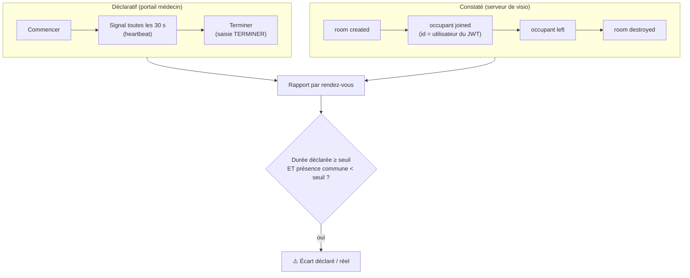

# Prouver qu'une téléconsultation a eu lieu : Jitsi auto-hébergé, événements de salle et écart déclaré / réel

*Sur une plateforme de télésanté, la téléconsultation devient une donnée de facturation. Or tout ce que le portail médecin sait déclarer — « j'ai commencé », « j'ai terminé » — peut être déclaré sans que le patient ne soit jamais venu. Il fallait une preuve que le navigateur ne peut pas fabriquer.*

---

## 🩺 Le contexte

La visio était intégrée en iframe dans les portails médecin et patient, d'abord via un service Jitsi hébergé (JaaS). Le backend signait un JWT par participant, la page affichait l'iframe, et c'était tout : **aucune trace de ce qui se passait dans la salle**.

Deux besoins sont arrivés en même temps :

1. **Côté produit** : une carte « en consultation » avec un bouton *Terminer*, parce que le webhook de fin du fournisseur n'arrivait pas toujours.
2. **Côté direction** : compter les consultations réellement tenues, par médecin, en vue de la facturation — et détecter le médecin qui lance la visio et la ferme aussitôt « pour faire le contact ».

Le piège : le bouton *Terminer* répond au besoin 1 et **aggrave** le besoin 2. Une déclaration du médecin, c'est un signal fourni par le client : il prouve qu'un onglet a envoyé une requête, pas qu'un patient était là.

---

## 🧭 Le principe : deux sources, jamais confondues



- Le **déclaratif** sert l'UX : la carte flottante, le chronomètre, la fin quand le fournisseur ne prévient pas.
- Le **constaté** sert la preuve : il vient du serveur de visio, serveur à serveur, authentifié.
- Le rapport les met **côte à côte** au lieu de laisser l'un écraser l'autre.

---

## 🛠️ Passer en auto-hébergé pour avoir les événements

Le service hébergé proposait des webhooks, mais leur configuration dépendait d'un compte externe et ne couvrait pas les environnements de développement. Jitsi auto-hébergé (`docker-jitsi-meet`, quatre conteneurs : web, prosody, jicofo, jvb) offre mieux : le module **`event_sync`** de *jitsi-contrib*, **déjà présent dans l'image Prosody**.

Activation : un fichier lu après la configuration principale (préfixe `zz-`), un composant par backend cible.

```lua
Component "event-sync.meet.jitsi" "event_sync_component"
    muc_component = "muc.meet.jitsi"
    api_prefix = "https://api.example.com/webhooks/jitsi"
    api_headers = { ["Authorization"] = "Bearer <jeton>"; }
    api_retry_count = 5
```

Prosody envoie alors `POST …/events/room/created`, `…/occupant/joined`, `…/occupant/left`, `…/room/destroyed`. Le point clé : **`occupant.id` reprend `context.user.id` du JWT**. Comme c'est le backend qui signe ce jeton, l'identité dans l'événement est celle qu'il a lui-même attribuée — impossible à usurper depuis le navigateur.

Deux pièges de déploiement, chacun une heure de perdue :

- `config/web` doit être traversable (0755) : sinon `config.js` répond 403 et l'iframe reste blanche.
- le dossier `conf.d` de Prosody doit être lisible par l'uid 100 : sinon le composant est **ignoré sans erreur**.

---

## 🧮 Reconstituer des séances, puis des consultations

### Côté backend : idempotent et tolérant

```python
async def ingest(event_type, payload):
    room = payload["room_name"]
    session = current_session(room) or None
    if session is None:
        appointment = find_appointment_by_room(room)
        if appointment is None:
            return {"status": "ignored", "reason": "room not linked to an appointment"}
        session = new_session(room, appointment)
    apply(session, event_type, payload, idempotency_key=...)   # rejouable sans doublon
```

Trois règles qui ont compté :

1. **Idempotence** : Prosody rejoue en cas d'échec. Chaque événement porte une clé (type + participant + horodatage) déjà traitée → ignorée.
2. **Ignorer ce qui n'est pas à soi** (200, pas 404) : un même serveur Jitsi sert deux environnements ; chaque backend écarte les salles inconnues sans faire échouer l'envoi.
3. **`room destroyed` fait foi** : il transporte la liste complète des participants depuis la création, ce qui rattrape un `left` perdu.

### La présence par intervalles

Pour chaque participant : une liste d'intervalles `[entrée, sortie]`. Le **chevauchement** entre les intervalles du médecin et ceux du patient donne le temps réellement passé ensemble. Une consultation est **effective** si ce chevauchement dépasse un seuil (2 minutes ici).

### La consultation = le rendez-vous, pas la connexion

Premier tableau de bord, premier test… et trois « séances » pour un seul rendez-vous : une vraie, deux rechargements de page de deux secondes. Compter des connexions n'a aucun sens métier. Le rapport regroupe désormais **par rendez-vous** :

| Champ | Source |
|---|---|
| Connexions, durée de visio | séances (constaté) |
| Temps ensemble | chevauchement médecin ∩ patient (constaté) |
| Durée déclarée | Commencer → Terminer (déclaratif) |
| Motif de fin | salle fermée / terminée par le médecin / onglet fermé |
| Statut | en cours, effective, trop courte, patient absent, médecin absent, **sans visio** |

Le statut **sans visio** est apparu en route : une consultation déclarée **sans aucune connexion** n'avait pas de séance, donc n'apparaissait nulle part. C'est pourtant le cas de fraude le plus simple. Le rapport part donc de l'union *rendez-vous avec séances* ∪ *rendez-vous avec déclaration*.

---

## ⏱️ L'onglet fermé : un heartbeat, pas un cron

Un médecin qui ferme son onglet ne clique pas sur *Terminer*. Plutôt qu'une tâche planifiée, l'onglet de visio envoie un signal toutes les 30 secondes ; une déclaration sans signal depuis 2 minutes est considérée terminée **à sa lecture**, avec `ended_by = "timeout"` et la fin fixée au dernier signal. Le rapport applique la même règle en lecture seule.

Avantage : aucune infrastructure de plus. Limite assumée : la fin n'est écrite qu'au moment où quelqu'un consulte la liste.

---

## 🖥️ Côté portail : rendre la fin volontaire

Le bouton *Terminer* d'une carte flottante était trop facile à cliquer par réflexe. Deux changements :

- une **saisie obligatoire du mot TERMINER**, avec un avertissement bien visible (« la salle de visio reste ouverte » depuis la carte, « l'appel sera coupé » depuis la visio) ;
- une **barre d'actions posée sur l'iframe** (coin supérieur droit, en `position: absolute` dans un conteneur relatif) : présence du patient en direct, chronomètre, dossier patient, plein écran, Terminer.

La présence affichée vient de l'API de l'iframe (`participantJoined` / `participantLeft`) : c'est de l'UX. La preuve, elle, reste côté serveur.

Détail utile : le plein écran doit porter sur **le conteneur** (iframe + barre), sinon la barre disparaît ; et une modale Mantine, rendue dans un portail hors de l'élément plein écran, est invisible tant qu'on n'en sort pas.

---

## 📊 Le résultat

Sur le tableau de bord d'administration, une ligne par rendez-vous, le détail des connexions dépliable, et un compteur **« Écarts déclaré / réel »** global et par médecin. Trois variantes :

- déclarée sans aucune connexion à la visio ;
- déclarée, patient jamais connecté ;
- déclarée bien plus longue que le temps passé ensemble.

Le premier rapport a d'ailleurs immédiatement levé des alertes… sur d'anciens tests faits avec le service hébergé, dont les webhooks n'arrivaient pas en local. **Une alerte d'écart n'a de sens que si la source constatée est branchée** : à afficher clairement par environnement.

---

## 🎓 Leçons

1. **Ne jamais facturer sur un signal client.** Le navigateur sert l'expérience ; la preuve vient du serveur, authentifiée et rejouable.
2. **L'identité dans l'événement doit être celle que vous avez signée** (`context.user.id` du JWT), pas un nom d'affichage.
3. **Comptez des objets métier**, pas des connexions : une consultation est un rendez-vous.
4. **Cherchez ce qui manque** : le cas « déclaré sans visio » n'apparaît pas tant qu'on part des séances.
5. **Un heartbeat lu paresseusement** remplace souvent un cron.
6. **Auto-héberger a un prérequis caché** : un relais TURN pour les réseaux qui bloquent l'UDP — sujet d'un [article dédié](/blog/relais-turn-webrtc-coturn-cloudflare-couts).

Le projet Docker Compose générique (JWT, `event_sync`, TURN optionnel) est disponible dans mon dépôt *docker-examples* : `compose/18-communication/visio/jitsi-meet`.
