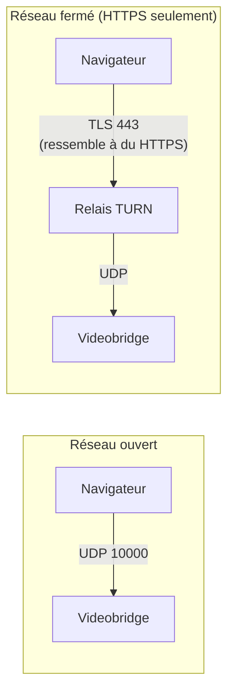
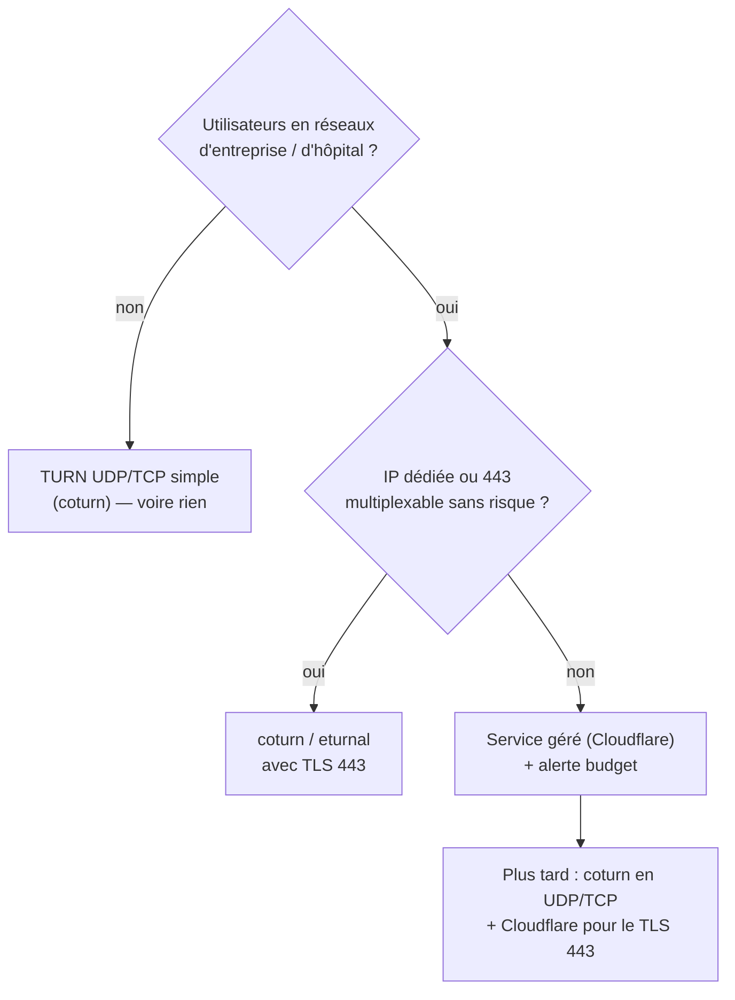

# Relais TURN pour la visio WebRTC : coturn ou Cloudflare, et combien ça coûte vraiment

*Quand on remplace un service de visio hébergé par son propre serveur, on récupère le contrôle, les données… et un problème que le fournisseur réglait en silence : les réseaux qui bloquent l'UDP.*

---

## 🧩 Ce que fait chaque brique

Un serveur Jitsi, ce sont quatre conteneurs. Pour comprendre TURN, deux suffisent :

| Brique | Rôle | Transport |
|---|---|---|
| **Prosody** | Le standard téléphonique : vérifie le jeton, gère les salles, relaie la signalisation | HTTPS 443 (WebSocket) |
| **Videobridge (JVB)** | Le serveur média : reçoit l'audio/vidéo de chacun et le redistribue | **UDP 10000** |

La signalisation passe par le web comme n'importe quel site. **Les médias, eux, exigent de l'UDP** vers le serveur.

---

## 🚧 Le symptôme : une salle sans son ni image

Dans la plupart des réseaux (box, 4G), le navigateur joint le videobridge en UDP et tout va bien. Mais certains réseaux ne laissent sortir que **HTTPS sur 443** : hôpitaux, entreprises, certains hôtels ou Wi-Fi publics.

Le participant voit alors la page, entre dans la salle (la signalisation passe), apparaît dans la liste… **et personne ne l'entend ni ne le voit**. Le pire des bugs : tout semble fonctionner.

---

## 🔁 TURN en une image



- Le navigateur parle au relais **comme à un site web** (TLS sur 443) : le pare-feu le laisse passer.
- Le relais ne sert **que si la connexion directe échoue** (mécanisme ICE) : la majorité des participants ne l'utilisent jamais.
- Il **ne peut pas lire** la conversation : les médias restent chiffrés (SRTP) entre le navigateur et le serveur média.

Côté Jitsi, c'est **Prosody** qui indique aux participants quels relais utiliser, avec des identifiants temporaires (`external_services`, XEP-0215).

> Les services hébergés (JaaS, etc.) fournissent ce relais d'office. C'est le prérequis caché de l'auto-hébergement : **sans TURN, pas de mise en production** si vos utilisateurs sont en milieu professionnel.

---

## 🧰 Les options open source

| Projet | Points forts | Limites |
|---|---|---|
| **coturn** | La référence, documentée par Jitsi. Prosody génère les identifiants à partir d'un **secret partagé** (`TURN_CREDENTIALS` dans docker-jitsi-meet) : zéro code | Configuration verbeuse, sécurité à durcir |
| **eturnal** (ProcessOne, Erlang) | Même mécanisme de secret partagé, configuration simple, image Docker officielle | Moins répandu |
| **STUNner** | TURN natif Kubernetes | Inutile hors Kubernetes |
| **Pion TURN** (Go) | Bibliothèque solide | Brique à intégrer, pas un serveur clé en main |

Deux points de durcissement indispensables pour coturn :

```ini
use-auth-secret                         # identifiants temporaires, jamais de compte fixe
denied-peer-ip=10.0.0.0-10.255.255.255  # idem 172.16/12, 192.168/16, 127/8, 169.254/16, fc00::/7
max-bps=3000000                         # débit par allocation
```

Sans les `denied-peer-ip`, un relais TURN devient un **proxy ouvert vers votre réseau interne**.

**Le vrai obstacle : le port 443.** C'est lui qui débloque les réseaux fermés, et il est presque toujours pris par le reverse proxy. Solutions : une IP dédiée au TURN, ou un multiplexage `nginx stream` avec `ssl_preread` qui aiguille le trafic TURN d'un côté et le web de l'autre — faisable, mais délicat sur un serveur de production.

---

## ☁️ L'option gérée : Cloudflare TURN

- `turn.cloudflare.com` en **anycast** : le client joint le point de présence le plus proche.
- Tous les transports : UDP 3478/443, TCP 3478/80, **TLS 5349/443**.
- Identifiants **générés par API**, avec durée de vie et révocation :

```bash
curl -X POST \
  -H "Authorization: Bearer $TURN_KEY_API_TOKEN" \
  -H "Content-Type: application/json" \
  -d '{"ttl": 86400}' \
  https://rtc.live.cloudflare.com/v1/turn/keys/$TURN_KEY_ID/credentials/generate-ice-servers
```

Intégration Jitsi : l'image Prosody accepte des **identifiants fixes** (`TURNS_HOST`, `TURN_USERNAME`, `TURN_PASSWORD`). On génère donc un identifiant à durée limitée, on le pose dans l'environnement, et une tâche planifiée le renouvelle avant expiration puis révoque l'ancien. Contrepartie : cet identifiant est commun à tous les participants ; durée courte, révocation et **alerte budget** limitent le risque.

---

## 💶 Combien ça coûte

Cloudflare facture **0,05 \$ par Go envoyé au client relayé** (gratuit seulement avec leur propre SFU, ce qui n'est pas le cas avec Jitsi). Une visio 720p représente environ **2 Mbit/s par participant**, soit **~0,9 Go/h**, soit **~0,045 \$ de l'heure par participant relayé**.

Pour des consultations de 30 minutes à deux participants :

| Volume mensuel | 15 % de participants relayés (courant) | 100 % relayés (pire cas) |
|---|---|---|
| 500 consultations | ≈ 3 \$ | ≈ 23 \$ |
| 2 000 consultations | ≈ 14 \$ | ≈ 90 \$ |
| 5 000 consultations | ≈ 34 \$ | ≈ 225 \$ |

coturn auto-hébergé : 0 € de licence, ~50 Mo de RAM ; le coût est dans **la bande passante du serveur** et dans le temps passé à l'exploiter (certificats, 443, mises à jour, surveillance).

---

## 🧭 Comment décider



Les deux approches se combinent : Prosody accepte plusieurs relais. Un coturn local absorbe la majorité des cas (UDP/TCP), le service géré ne prend que les réseaux les plus fermés.

---

## 🎓 Leçons

1. **Tester depuis un réseau fermé avant la mise en production** : un partage de connexion avec un pare-feu qui ne laisse passer que le 443 suffit à reproduire le problème.
2. **« La salle s'ouvre » ne veut pas dire « la visio marche »** : la signalisation et les médias ne prennent pas le même chemin.
3. **Le TURN est un service exposé** : identifiants temporaires, interdiction des réseaux privés, limites de débit.
4. **Chiffrer le coût par participant relayé**, pas par consultation : seule une minorité passe par le relais.
5. **Le service hébergé que vous quittez faisait plus que vous ne le pensiez** : faites l'inventaire avant de migrer.

Le projet Docker Compose de référence (Jitsi + coturn en profil optionnel, ou identifiants Cloudflare) est dans *docker-examples* : `compose/18-communication/visio/jitsi-meet`. Le contexte complet est dans l'article [Prouver qu'une téléconsultation a eu lieu](/blog/prouver-teleconsultation-jitsi-event-sync-ecart-declare-reel).
