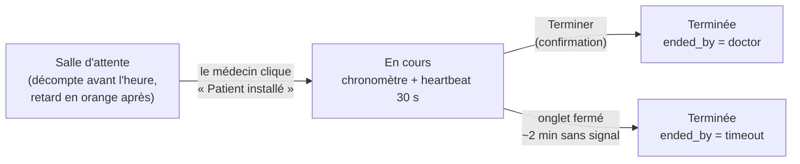

# Compter les consultations en présentiel quand on n'a que le navigateur du médecin

*La plateforme comptait déjà les téléconsultations, avec une preuve côté serveur. Restait la moitié de l'activité : les patients reçus au cabinet. Aucun serveur de visio, aucun patient connecté, un seul témoin — l'onglet du médecin. Il fallait compter honnêtement, sans prétendre prouver ce qu'on ne peut pas prouver.*

---

## 🩺 Le contexte

Sur la plateforme de télésanté, une téléconsultation est comptée à partir de deux sources, détaillées dans l'article [Prouver qu'une téléconsultation a eu lieu](/blog/prouver-teleconsultation-jitsi-event-sync-ecart-declare-reel) :

- le **constaté** : les événements de salle du serveur Jitsi (entrées, sorties, durée commune médecin/patient) ;
- le **déclaratif** : les boutons *Commencer* / *Terminer* du médecin, avec un signal de présence.

Le rapport les confronte et lève une alerte « déclarée sans visio » quand une consultation est déclarée sans aucune connexion.

Pour le **présentiel**, le constaté n'existe pas. Le patient est assis en face du médecin, pas devant un écran. Il n'y a donc rien à confronter.

---

## 🧭 Le principe : la même déclaration, un autre mode

Plutôt qu'un second modèle de données, on réutilise la déclaration existante avec un champ de plus :

```json
{
  "appointment_id": "rdv-1234",
  "mode": "in_person",
  "started_at": "2026-10-14T09:02:11Z",
  "last_heartbeat_at": "2026-10-14T09:21:41Z",
  "ended_at": "2026-10-14T09:21:55Z",
  "ended_by": "doctor"
}
```

Conséquences dans le rapport :

| | Téléconsultation (`mode: video`) | Présentiel (`mode: in_person`) |
|---|---|---|
| Durée déclarée | Commencer → Terminer | Commencer → Terminer |
| Présence constatée | événements Jitsi | — |
| Alerte « déclarée sans visio » | oui | **non** (ce serait toujours vrai) |
| Comptage | ligne « visio » | **ligne à part** |

Le présentiel est **compté à part**, jamais mélangé aux visios, et n'est pas soumis à une alerte qui n'a pas de sens pour lui. C'est une déclaration, et le rapport l'affiche comme telle.

---

## 🖥️ L'écran : salle d'attente, chronomètre, signal de présence



- **La salle d'attente** est le composant générique déjà utilisé pour la visio : décompte jusqu'à l'heure du rendez-vous, puis affichage du **retard en orange**. Le démarrage est **manuel** : le médecin clique quand le patient est installé, pas à l'heure théorique.
- **Le chronomètre** affiche la durée écoulée depuis le démarrage déclaré.
- **Le signal de présence** part toutes les 30 secondes. Sans signal pendant environ 2 minutes, la consultation est considérée terminée au dernier signal, avec `ended_by = "timeout"` : un onglet fermé ne laisse pas une consultation ouverte pour la journée.

---

## 🎙️ La transcription : le texte, pas l'audio

Les médecins voulaient une aide à la rédaction : une transcription de l'échange. La décision a été prise avant d'écrire une ligne de code : **transcription seule, audio non conservé**. Les segments audio transitent vers le service de transcription et ne sont stockés nulle part.

### Le consentement avant le micro

Le micro ne s'ouvre pas tant que le médecin n'a pas coché « Le patient a donné son consentement à la transcription ». Et ce consentement est **tracé côté serveur**, dans le journal d'audit, avant toute capture :

```ts
async function startTranscription(appointmentId: string) {
  // 1. Le consentement est enregistré côté serveur (audit) AVANT le micro
  await api.post(`/appointments/${appointmentId}/transcription-consent`, {
    consent: true,
  });
  // 2. Seulement ensuite : demande d'accès au micro
  const stream = await navigator.mediaDevices.getUserMedia({ audio: true });
  return startSegmentedRecording(stream, appointmentId);
}
```

Une case cochée côté client ne prouve rien ; une entrée d'audit horodatée, liée au rendez-vous et au médecin, si.

### Des segments de 60 secondes, autonomes

Première idée : un seul `MediaRecorder` avec `start(60000)` et un `ondataavailable` toutes les minutes. Problème : seul le **premier** morceau contient l'en-tête du conteneur (WebM ou MP4). Les suivants ne sont pas lisibles seuls, et le service de transcription les rejette.

Solution : **un nouvel enregistreur par segment**. Chaque segment est un fichier complet.

```ts
const SEGMENT_MS = 60_000;

function pickMimeType(): string {
  const candidates = ["audio/webm;codecs=opus", "audio/mp4"]; // mp4 : Safari
  return candidates.find((t) => MediaRecorder.isTypeSupported(t)) ?? "";
}

function startSegmentedRecording(stream: MediaStream, appointmentId: string) {
  const mimeType = pickMimeType();
  const queue = createSequentialQueue();      // un envoi à la fois, dans l'ordre
  let stopped = false;
  let index = 0;

  const recordOne = () => {
    if (stopped) return;
    const recorder = new MediaRecorder(stream, mimeType ? { mimeType } : undefined);
    const chunks: Blob[] = [];
    const n = index++;

    recorder.ondataavailable = (e) => e.data.size && chunks.push(e.data);
    recorder.onstop = () => {
      const blob = new Blob(chunks, { type: recorder.mimeType });
      queue.push(() => uploadSegment(appointmentId, n, blob));
      recordOne();                            // segment suivant
    };

    recorder.start();
    setTimeout(() => recorder.state === "recording" && recorder.stop(), SEGMENT_MS);
  };

  recordOne();
  return {
    stop() {
      stopped = true;
      stream.getTracks().forEach((t) => t.stop());   // libère le micro
      return queue.drain();                          // attend les derniers envois
    },
  };
}

function createSequentialQueue() {
  let tail = Promise.resolve();
  return {
    push(task: () => Promise<unknown>) {
      tail = tail.then(task).catch((err) => console.error("segment", err));
    },
    drain: () => tail,
  };
}
```

Trois points :

- **La file séquentielle** envoie les segments un par un, dans l'ordre : le texte se reconstitue sans tri, et un réseau lent ne déclenche pas dix envois parallèles.
- **`MediaRecorder.isTypeSupported`** choisit le format : `audio/webm;codecs=opus` sur Chrome et Firefox, `audio/mp4` sur Safari. Le type réel (`recorder.mimeType`) accompagne chaque segment.
- **Arrêter les pistes** à la fin : sinon l'indicateur de micro du navigateur reste allumé, ce qui inquiète légitimement le patient.

---

## 🚪 La garde de fermeture

Pendant la capture, fermer l'onglet ou cliquer ailleurs perd le segment en cours. Il faut prévenir. `beforeunload` couvre la fermeture et le rechargement… mais **pas la navigation client de Next.js** : cliquer sur un lien interne change de page sans décharger le document, et `beforeunload` ne se déclenche jamais.

D'où un hook qui couvre les deux :

```ts
import { useEffect } from "react";

export function useLeaveGuard(active: boolean, message: string) {
  useEffect(() => {
    if (!active) return;

    // Fermeture d'onglet, rechargement, navigation externe
    const onBeforeUnload = (e: BeforeUnloadEvent) => {
      e.preventDefault();
      e.returnValue = ""; // le navigateur affiche son propre texte
    };

    // Liens internes (navigation client Next.js)
    const onClick = (e: MouseEvent) => {
      if (e.defaultPrevented || e.button !== 0 || e.metaKey || e.ctrlKey || e.shiftKey) return;
      const link = (e.target as Element | null)?.closest("a[href]") as HTMLAnchorElement | null;
      if (!link || link.target === "_blank") return;
      const url = new URL(link.href, window.location.href);
      if (url.origin !== window.location.origin) return; // externe : beforeunload s'en charge
      if (!window.confirm(message)) {
        e.preventDefault();
        e.stopPropagation();
      }
    };

    window.addEventListener("beforeunload", onBeforeUnload);
    document.addEventListener("click", onClick, true); // phase de capture : avant le routeur
    return () => {
      window.removeEventListener("beforeunload", onBeforeUnload);
      document.removeEventListener("click", onClick, true);
    };
  }, [active, message]);
}
```

L'écouteur est posé **en phase de capture** sur le document : il passe avant le gestionnaire de clic du composant `Link`, qui peut donc être annulé. Usage :

```ts
useLeaveGuard(isRecording, "La transcription est en cours. Quitter la page arrête l'enregistrement.");
```

### En visio : une seule façon de terminer

Le même problème existait en téléconsultation, sous une autre forme : le bouton « raccrocher » de Jitsi termine l'appel **sans** passer par la déclaration *Terminer*. On le retire de la barre d'outils de l'iframe :

```ts
const api = new JitsiMeetExternalAPI(domain, {
  roomName,
  jwt,
  parentNode: container,
  configOverwrite: {
    toolbarButtons: ["microphone", "camera", "desktop", "chat", "tileview", "settings"],
    // pas de "hangup" : la fin passe par le bouton de la page
  },
});
```

La fin passe alors par un bouton maison, avec une **modale de confirmation** qui demande de saisir un mot : impossible de terminer par réflexe, et la déclaration est toujours envoyée.

---

## ⚖️ Limites assumées

- **La durée du présentiel est déclarée par le médecin.** Rien côté serveur ne prouve que le patient était là. Le rapport l'affiche comme une déclaration, à part, sans prétendre le contraire.
- **Le texte transcrit n'est pas encore persisté** : son stockage (où, combien de temps, qui y accède) reste à décider.
- **Safari reste à tester** sur des consultations longues : le choix `audio/mp4` est en place, mais pas encore éprouvé en conditions réelles.
- **La garde de fermeture ne couvre que les liens** : un `router.push()` déclenché par du code applicatif doit être protégé à part.

---

## 🎓 Leçons

1. **Réutiliser le modèle, différencier le mode** : un champ `mode` vaut mieux qu'un second circuit de comptage, à condition de ne pas mélanger les chiffres.
2. **Ne pas appliquer une alerte qui n'a pas de sens** : « déclarée sans visio » est toujours vrai en présentiel.
3. **Décider de la conservation avant le code** : « transcription seule, audio non conservé » simplifie tout ce qui suit.
4. **Le consentement se trace côté serveur, avant le micro** — pas dans un état React.
5. **Un `MediaRecorder` par segment** pour obtenir des fichiers autonomes, et une file séquentielle pour les envoyer.
6. **`beforeunload` ne voit pas la navigation client** : intercepter les clics en phase de capture.
7. **Une seule porte de sortie** : masquer le « raccrocher » natif pour que la fin passe toujours par la déclaration.
