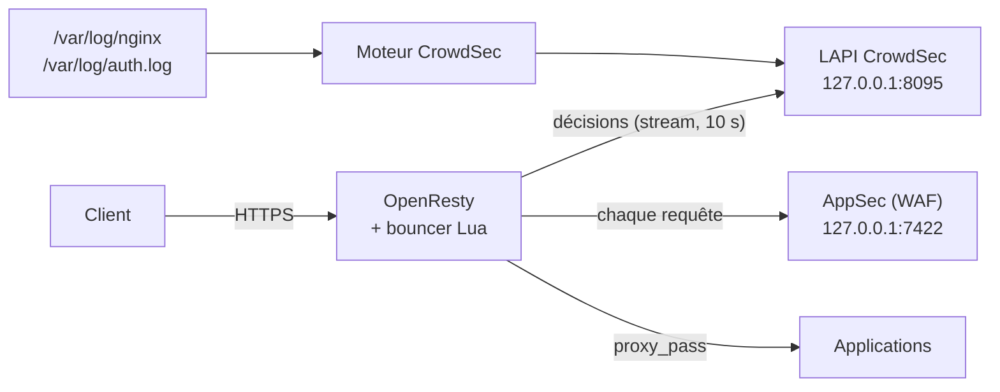

# CrowdSec et WAF AppSec devant OpenResty : ce qui est bloqué, ce qui ne l'est pas

*Un WAF qu'on n'a pas testé est un WAF dont on ne sait rien. Après avoir remplacé nginx par OpenResty, il restait à brancher CrowdSec, puis à vérifier, attaque par attaque, ce qui était réellement arrêté. Le bilan est plus nuancé que la page d'accueil du produit.*

---

## 🧩 L'architecture

La plateforme (données de santé, hébergement HDS, deux serveurs Ubuntu 22.04 et un serveur de recette) a désormais un frontal **OpenResty en conteneur** qui relit la configuration nginx existante — c'est l'objet de l'[article précédent](/blog/nginx-vers-openresty-conteneur-sans-reecrire-vhosts). CrowdSec s'y branche en deux morceaux :



- Le **moteur** lit les journaux, reconnaît des scénarios (scan, force brute, exploitation de CVE) et produit des **décisions** (ban d'IP).
- Le **bouncer**, dans OpenResty, applique ces décisions et soumet chaque requête au **composant AppSec**, le WAF.

---

## 🛠️ Le moteur CrowdSec en conteneur

```yaml
# /opt/crowdsec/compose.yml
services:
  crowdsec:
    image: registry.example.com/infra/crowdsec:v1.8.1
    container_name: crowdsec
    network_mode: host
    restart: unless-stopped
    environment:
      COLLECTIONS: >-
        crowdsecurity/linux crowdsecurity/nginx crowdsecurity/base-http-scenarios
        crowdsecurity/http-cve crowdsecurity/appsec-virtual-patching
        crowdsecurity/appsec-generic-rules
      DISABLE_ONLINE_API: "true"
    volumes:
      - ./config/config.yaml.local:/etc/crowdsec/config.yaml.local:ro
      - ./config/acquis.d:/etc/crowdsec/acquis.d:ro
      - crowdsec-db:/var/lib/crowdsec/data
      - crowdsec-config:/etc/crowdsec
      - /var/log/nginx:/var/log/nginx:ro
      - /var/log/auth.log:/var/log/auth.log:ro
volumes:
  crowdsec-db:
  crowdsec-config:
```

La LAPI écoute sur **127.0.0.1:8095**, parce que le 8080 par défaut était déjà pris par un autre service local :

```yaml
# config/config.yaml.local
api:
  server:
    listen_uri: 127.0.0.1:8095
```

Les sources à lire, dont le composant AppSec lui-même :

```yaml
# config/acquis.d/nginx.yaml
filenames: [/var/log/nginx/*.log]
labels: { type: nginx }
---
# config/acquis.d/auth.yaml
filenames: [/var/log/auth.log]
labels: { type: syslog }
---
# config/acquis.d/appsec.yaml
source: appsec
listen_addr: 127.0.0.1:7422
appsec_config: crowdsecurity/appsec-default
labels: { type: appsec }
```

Choix délibéré : **la CRS OWASP n'est pas activée**. Sur des formulaires médicaux pleins de texte libre, d'apostrophes, de chevrons et d'abréviations, ses règles génériques produisent des faux positifs ; et un faux positif, ici, c'est une ordonnance qui ne s'enregistre pas. On garde le *virtual patching* (CVE connues) et les règles génériques CrowdSec, plus ciblées.

---

## 🧱 Le bouncer Lua : une image maison, minimale

Le bouncer est composé de deux bibliothèques **en Lua pur** : `lua-cs-bouncer` (CrowdSec) et `lua-resty-http` (client HTTP). Rien à compiler. L'image se résume donc à l'image officielle OpenResty bookworm + deux archives, à des versions figées, vérifiées par sha256 :

```dockerfile
FROM registry.example.com/infra/openresty:1.27-bookworm

ARG CS_LUA_VERSION
ARG CS_LUA_SHA256
ARG RESTY_HTTP_VERSION
ARG RESTY_HTTP_SHA256

ADD --checksum=sha256:${CS_LUA_SHA256} \
    https://github.com/crowdsecurity/lua-cs-bouncer/archive/refs/tags/v${CS_LUA_VERSION}.tar.gz \
    /tmp/cs.tar.gz
ADD --checksum=sha256:${RESTY_HTTP_SHA256} \
    https://github.com/ledgetech/lua-resty-http/archive/refs/tags/v${RESTY_HTTP_VERSION}.tar.gz \
    /tmp/http.tar.gz

RUN mkdir -p /usr/local/lua/crowdsec /tmp/cs /tmp/http \
 && tar -xzf /tmp/cs.tar.gz   -C /tmp/cs   --strip-components=1 \
 && tar -xzf /tmp/http.tar.gz -C /tmp/http --strip-components=1 \
 && cp -r /tmp/cs/lib/*            /usr/local/lua/crowdsec/ \
 && cp -r /tmp/cs/templates        /usr/local/lua/crowdsec/ \
 && cp -r /tmp/http/lib/resty/*    /usr/local/openresty/lualib/resty/ \
 && rm -rf /tmp/cs* /tmp/http*
```

Pourquoi pas l'image `crowdsecurity/openresty`, prévue pour ça ?

| Point | Problème pour nous |
|---|---|
| Base `alpine-fat` non figée | La base change sous nos pieds, avec des outils de compilation embarqués |
| Pas d'utilisateur `www-data` | La configuration existante tourne en `user www-data;` (uid 33) |
| Script de démarrage qui **écrit dans `/etc/nginx`** | Notre configuration est montée **en lecture seule** : le conteneur ne démarre pas |

Et pourquoi pas une étape `luarocks install` ? Parce qu'il n'y a pas de C à compiler, et qu'un **sha256 figé dans le Dockerfile** est une garantie plus forte qu'une résolution réseau au moment du build.

### Le branchement dans la configuration

```nginx
# /etc/nginx/conf.d/crowdsec.conf (simplifié)
lua_package_path '/usr/local/lua/crowdsec/?.lua;;';
lua_shared_dict crowdsec_cache 50m;
lua_ssl_trusted_certificate /etc/ssl/certs/ca-certificates.crt;

init_by_lua_block {
  cs = require "crowdsec"
  local ok, err = cs.init("/etc/crowdsec/bouncers/crowdsec-openresty-bouncer.conf",
                          "crowdsec-openresty-bouncer")
  if ok == nil then ngx.log(ngx.ERR, "[crowdsec] " .. err) end
}

init_worker_by_lua_block {
  cs = require "crowdsec"
  if string.lower(cs.get_mode()) == "stream" then cs.SetupStream() end
}

access_by_lua_block {
  local cs = require "crowdsec"
  cs.Allow(ngx.var.remote_addr)
}
```

```ini
# /etc/crowdsec/bouncers/crowdsec-openresty-bouncer.conf (0600, déposé par Ansible)
API_URL=http://127.0.0.1:8095
API_KEY=<clé générée par cscli bouncers add>
MODE=stream
UPDATE_FREQUENCY=10
APPSEC_URL=http://127.0.0.1:7422
APPSEC_FAILURE_ACTION=passthrough
APPSEC_CONNECT_TIMEOUT=100
APPSEC_SEND_TIMEOUT=100
APPSEC_PROCESS_TIMEOUT=500
```

Trois réglages comptent :

- **`MODE=stream`** : les décisions sont mises en cache dans OpenResty et rafraîchies **toutes les 10 secondes**. Pas d'appel à la LAPI par requête.
- **`APPSEC_FAILURE_ACTION=passthrough`** : si le WAF ne répond pas, la requête passe. Sur une plateforme de soins, **le WAF ne doit jamais couper le service** ; un WAF en panne qui bloque tout est pire qu'un WAF absent.
- **Les timeouts AppSec**, fixés explicitement (connexion 100 ms, envoi 100 ms, traitement 500 ms), bornent ce qu’une requête peut attendre du WAF.

---

## 🧪 Ce qui est bloqué, mesuré

### Ban d'IP

```bash
cscli decisions add --ip 203.0.113.10 --duration 10m --reason "test recette"
# depuis 203.0.113.10 :
curl -s -o /dev/null -w '%{http_code}\n' https://app.example.com/   # 403 après ~10 s
cscli decisions delete --ip 203.0.113.10                             # 200 à nouveau
```

Le délai d'environ **10 secondes** correspond exactement à l'intervalle du mode stream. Levée de la décision : même délai, retour à la normale.

### WAF AppSec

| Requête testée | Résultat |
|---|---|
| `GET /.env` | ✅ bloquée (403, virtual patching) |
| `GET /.git/config` | ✅ bloquée (403, virtual patching) |
| `POST /vendor/phpunit/phpunit/src/Util/PHP/eval-stdin.php` (CVE-2017-9841) | ✅ bloquée (403, page « CrowdSec Ban ») |
| Injection SQL générique (`?id=1' OR '1'='1`) | ❌ passe |
| Traversée de répertoire générique (`?f=../../etc/passwd`) | ❌ passe |
| Charge log4shell générique (`${jndi:ldap://…}` en en-tête) | ❌ passe |

**Piège du test officiel.** La documentation propose `curl /.env` → 403. Sur des vhosts qui contiennent déjà `location ~ /\.(?!well-known) { deny all; }`, c'est **nginx** qui répond 403 (page générique « 403 Forbidden — openresty »), dans sa phase d'accès, **avant** que le bouncer n'envoie la requête à AppSec : le test passe même si le WAF est en panne. Le signe qui ne trompe pas est la page « CrowdSec Ban » et, surtout, le compteur `Blocked` de `cscli metrics show appsec` avec le nom de la règle. Pour tester un serveur ainsi configuré, il faut une attaque que nginx ne filtre pas, comme l'exploit PHPUnit ci-dessus.

C'est **cohérent avec la configuration choisie** : sans CRS, le WAF bloque des chemins et des signatures de CVE précises, pas les familles d'attaques génériques. Il faut le savoir et l'écrire, plutôt que de laisser croire qu'un « WAF » protège de l'injection SQL. La protection contre ces familles reste dans le code (requêtes paramétrées, validation des chemins) et, si besoin, dans une activation progressive de la CRS en mode détection seule.

---

## ⏱️ « On dirait qu'il y a de la latence »

La remarque est arrivée le lendemain de la mise en service. Plutôt que de répondre au ressenti, deux mesures.

**Côté serveur, en A/B.** Le temps de traitement nginx (`$request_time`) est journalisé. AppSec désactivé une minute, puis réactivé, sur le même vhost :

```bash
# médiane de $request_time (dernier champ du format de log) sur une fenêtre
awk '{print $NF}' /var/log/nginx/app.access.log | sort -n \
  | awk '{a[NR]=$1} END {print a[int(NR/2)+1]}'
```

Écart mesuré : **1 à 3 ms par requête**.

**Côté utilisateur.** L'historique de la sonde Uptime Kuma sur la même page : **89 ms avant, 93 ms pendant, 88 ms après**. Du bruit.

Conclusion partagée avec l'équipe, chiffres à l'appui : la lenteur ressentie ne venait pas du WAF. La démarche compte plus que le résultat — mesurer côté serveur et côté client, avec un A/B court, avant de désactiver une protection « pour voir ».

---

## 📜 Des logs « trop de STDERR »

Deuxième remarque : le conteneur CrowdSec remplit les journaux. Exact, et pour deux raisons :

1. CrowdSec écrit **tout sur stderr**, y compris l'information. Les outils de supervision le classent donc en erreur.
2. **85 % des lignes** étaient le journal d'accès de la LAPI : le bouncer l'interroge toutes les 10 secondes, et chaque appel était tracé.

Correctif :

```yaml
# config/config.yaml.local
api:
  server:
    listen_uri: 127.0.0.1:8095
    log_level: warning
```

Les ~**200 lignes au démarrage** (chargement des règles AppSec) restent, et c'est normal.

---

## 🚪 La force brute SSH : détectée, bannie… et pas bloquée

En lisant `cscli alerts list`, une surprise : des scénarios `ssh-bf` déclenchés en continu, des décisions de ban prononcées. Tout semblait fonctionner.

Sauf que **le bouncer OpenResty ne protège que HTTP**. Une IP bannie pour force brute SSH ne peut plus charger une page web, mais elle peut continuer à essayer des mots de passe sur le port 22. La décision existe ; **personne ne l'applique** là où l'attaque a lieu.

Pour que les décisions s'appliquent à tous les ports, il faut un **bouncer pare-feu** (nftables/iptables) sur l'hôte. C'est la prochaine étape. L'authentification SSH par clé uniquement, elle, rendrait la force brute inoffensive quoi qu'il arrive.

Autre décision laissée ouverte : le **partage communautaire (CAPI)** est **désactivé** (`DISABLE_ONLINE_API`). L'activer apporte la liste de blocage communautaire, en échange de l'envoi des IP attaquantes observées. Ce ne sont pas des données de santé, mais c'est un flux sortant vers un tiers à documenter : décision à prendre explicitement, pas par défaut.

---

## 🧰 Commandes d'exploitation

```bash
alias cscli='docker exec crowdsec cscli'

cscli decisions list                       # bans actifs
cscli decisions delete --ip 203.0.113.10   # lever un ban (faux positif)
cscli alerts list                          # ce qui a été détecté, et par quel scénario
cscli metrics show appsec                  # requêtes traitées / bloquées par le WAF
cscli bouncers list                        # le bouncer OpenResty est-il vu (dernier contact) ?
```

`cscli bouncers list` est le premier réflexe en cas de doute : un bouncer dont le dernier contact date de plus de quelques secondes n'applique plus rien.

---

## 🎓 Leçons

1. **Tester chaque promesse** : un ban, une CVE connue que nginx ne filtre pas, une injection SQL — et lire le compteur `Blocked`, pas seulement le code HTTP. Le tableau de résultats vaut plus que la liste des collections installées.
2. **« WAF » ne veut pas dire « protégé contre tout »** : sans CRS, pas de protection générique — et c'était un choix assumé contre les faux positifs.
3. **Un WAF ne doit jamais devenir un point de panne** : `passthrough` et des timeouts courts.
4. **Une décision n'est rien sans un bouncer au bon endroit** : HTTP ne protège pas SSH.
5. **Répondre à « c'est lent » par une mesure** : A/B côté serveur, historique côté client.
6. **Images minimales et figées** : deux archives Lua vérifiées par sha256 plutôt qu'une image tout-en-un qui réécrit votre configuration.
