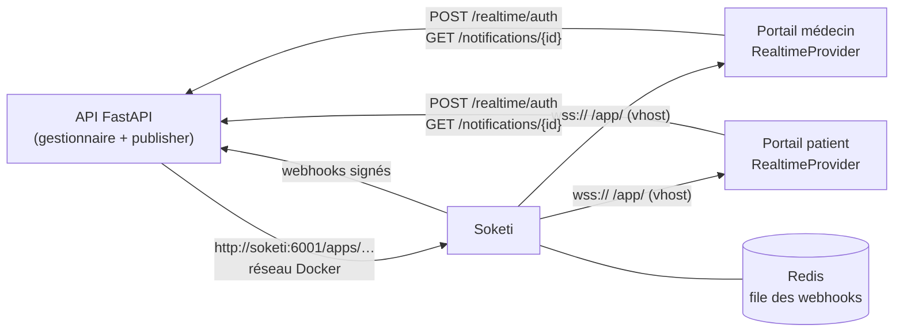

# Temps réel full stack avec Soketi : notifier deux portails Next.js depuis FastAPI, à la manière de Laravel

*Les notifications existaient déjà : persistées en base, visibles en rechargeant la page. Il manquait le « temps réel » — la cloche qui s'incrémente pendant que le médecin consulte un dossier, le toast « nouveau rendez-vous » côté patient. Plutôt que d'inventer un protocole, on a copié Laravel, sans Laravel.*

---

## 🧩 Le contexte

La plateforme de santé compte deux portails Next.js (médecin et patient), une API FastAPI et des données sensibles. Un gestionnaire de notifications existait déjà côté backend : il choisit les canaux (e-mail, SMS, in-app) selon les préférences de chaque utilisateur et enregistre la notification in-app en base.

Le besoin : pousser chaque nouvelle notification in-app vers les onglets ouverts de son destinataire, et seulement les siens.

---

## 🔌 Pourquoi Soketi

[Soketi](https://docs.soketi.app) est un serveur WebSocket auto-hébergé qui implémente le **protocole Pusher**. Cela suffit à tout débloquer :

- côté navigateur, on réutilise **`laravel-echo` + `pusher-js`**, bibliothèques mûres, avec reconnexion, canaux privés et authentification déjà gérés ;
- côté backend, on publie avec le **SDK Python `pusher`** : un appel HTTP signé, rien à maintenir ;
- aucune donnée ne quitte nos serveurs, contrairement au service Pusher hébergé.

Laravel a popularisé cette architecture. Voici comment chaque pièce se traduit dans une stack Python + Next.js :

| Laravel | Notre stack |
|---|---|
| Notification avec canal `broadcast` / `ShouldBroadcast` | Gestionnaire de notifications + *publisher* Soketi |
| Canal `App.Models.User.{id}` | Canal privé `private-user.<id>` |
| `routes/channels.php` + `/broadcasting/auth` | `POST /realtime/auth` : le backend ne signe **que** le canal de l'utilisateur connecté |
| `Echo.private(...).listen()` | Un `RealtimeProvider` React par portail |
| `toArray()` / `toBroadcast()` | `to_in_app()` qui déclare titre, corps et actions |

L'autorisation tient en quelques lignes, et c'est la pièce la plus importante :

```python
@router.post("/realtime/auth")
async def realtime_auth(socket_id: str = Form(), channel_name: str = Form(),
                        user: CurrentUser = Depends(get_current_user)):
    if channel_name != f"private-user.{user.id}":
        raise HTTPException(status_code=403)
    return soketi.authenticate(channel=channel_name, socket_id=socket_id)
```

---

## 🔒 L'événement ne transporte qu'une référence

Règle posée avant la première ligne de code : **aucun titre, aucun corps dans le WebSocket**. Un événement dit « il y a une notification n°X, de tel type », rien de plus. Le portail relit ensuite la notification par l'API authentifiée pour afficher le toast.

```python
class NotificationAction(BaseModel):
    action: Literal["view", "http"]
    code: str                      # ex. "appointment.open"
    params: dict[str, str] = {}    # identifiants opaques uniquement
    clear: bool = False

class NotificationCreatedEvent(BaseModel):
    id: str
    type: str
    category: str
    priority: int = Field(ge=1, le=5)
    actions: list[NotificationAction] = []
```

Ce que cela apporte :

- un canal mal autorisé, un journal de proxy trop bavard ou une extension de navigateur curieuse ne voient **aucune donnée de santé** ;
- la notification affichée est toujours celle de la base, avec les droits de l'API ;
- l'événement reste petit et stable, quel que soit le contenu.

Le coût : un aller-retour HTTP par notification. Pour quelques événements par heure et par utilisateur, il est négligeable.

---

## 🧭 Un modèle d'actions inspiré de ntfy

Une notification utile mène quelque part : « ouvrir le rendez-vous », « voir l'ordonnance ». Plutôt qu'une URL codée en dur (qui diffère entre portails), on s'est inspiré des [actions de ntfy](https://docs.ntfy.sh/publish/#action-buttons) :

```json
{ "action": "view", "code": "appointment.open",
  "params": { "appointment_id": "a-123" }, "clear": true }
```

- **priorité 1 à 5**, dérivée de la criticité métier, comme ntfy ;
- **tags** = la catégorie (rendez-vous, prescription, message) ;
- **chaque portail a son registre `code → page`** : le même code `appointment.open` ouvre `/calendar` côté médecin et `/RDV` côté patient.

```js
// portail patient — registre des actions
export const ACTIONS = {
  'appointment.open': ({ appointment_id }) => `/RDV?appointment=${appointment_id}`,
  'prescription.open': ({ prescription_id }) => `/prescriptions/${prescription_id}`,
};
```

Côté backend, **création stricte, lecture tolérante** : les codes sont une `Enum` à la création (une faute de frappe échoue au test), mais un simple `str` à la lecture, pour que les anciennes notifications, enregistrées avant l'introduction des actions ou avec un code retiré depuis, s'affichent sans erreur. Un code inconnu côté portail donne une notification sans bouton, jamais une page cassée.

---

## 🛰️ L'architecture déployée



**Exposition minimale.** Le vhost nginx n'expose **que** le WebSocket :

```nginx
location /app/ {
    proxy_pass http://127.0.0.1:6001;
    proxy_http_version 1.1;
    proxy_set_header Upgrade $http_upgrade;
    proxy_set_header Connection "upgrade";
    proxy_read_timeout 3600s;
}
location / { return 404; }   # /apps/… (publication), /metrics : internes
```

L'API de publication `/apps/…` est signée, mais elle n'a aucune raison d'être joignable depuis Internet : depuis l'extérieur, elle répond 404. Le backend, lui, publie sur `http://soketi:6001` par le réseau Docker.

---

## 🪤 Les pièges

### 1. L'`app_id` doit être numérique

Nos premiers identifiants d'application étaient lisibles (`platform-dev`). Soketi les accepte sans broncher, les navigateurs se connectent… et **aucune publication ne part** :

```
ValueError: Invalid app id
```

Le SDK Python `pusher` valide l'id par une expression régulière `^[0-9]+$`. L'erreur, levée côté backend, était avalée par le gestionnaire de notifications (la persistance passait, seul le temps réel échouait). Correctif : des ids numériques, et un journal d'erreur explicite quand la publication échoue.

### 2. pusher-js et Soketi : transports et `cluster`

```js
window.Pusher = Pusher;
const echo = new Echo({
  broadcaster: 'pusher',
  key: process.env.NEXT_PUBLIC_SOKETI_KEY,
  wsHost: 'socket.example.com',
  wssPort: 443,
  forceTLS: true,
  enabledTransports: ['ws', 'wss'],  // sinon replis HTTP qui échouent
  cluster: 'mt1',                    // exigé par pusher-js, ignoré par Soketi
  enableStats: false,
  authEndpoint: '/api/realtime/auth',
});
```

Avec `forceTLS`, pusher-js veut `enabledTransports` explicite, faute de quoi il tente des transports que Soketi ne sert pas. Et l'option `cluster` est obligatoire, même si elle n'a aucun sens hors du service Pusher.

### 3. Deux réseaux Docker

Les portails se connectaient, la cloche affichait « connecté », mais rien n'arrivait. Soketi n'était que sur le réseau du reverse proxy ; les backends vivaient sur un autre réseau. Le nom `soketi` n'était pas résolu depuis l'API, et l'échec de publication passait inaperçu (cf. piège 1). Correctif : **relier Soketi aux deux réseaux**.

### 4. Les limites de Soketi

Compatible Pusher ne veut pas dire identique. Documentées une fois pour toutes :

| Fonction Pusher | Soketi |
|---|---|
| Paramètre `info` (ex. `subscription_count`) à la publication | ❌ non supporté |
| Canaux en *query string* sur `/events` | ❌ uniquement dans le corps JSON |
| Transports HTTP de repli | ❌ ws / wss seulement |
| Collecte des stats client | ❌ → `enableStats: false` |
| Supervision | ✅ métriques Prometheus (port 9601) |

---

## 👁️ Connecté / déconnecté : les webhooks

Soketi émet des webhooks `channel_occupied` (premier abonné à un canal) et `channel_vacated` (dernier abonné parti). Filtrés sur le préfixe `private-user.`, ils disent exactement si un utilisateur a au moins un onglet ouvert :

```bash
SOKETI_DEFAULT_APP_WEBHOOKS='[{"url":"http://api:8000/realtime/webhooks",
  "event_types":["channel_occupied","channel_vacated"],
  "filter":{"channel_name_starts_with":"private-user."}}]'
SOKETI_QUEUE_DRIVER=redis
SOKETI_DB_REDIS_HOST=redis
```

Chaque appel est signé : `X-Pusher-Signature` = HMAC-SHA256 du corps avec le secret de l'application. Le backend le vérifie avec `hmac.compare_digest` avant d'écrire « connecté » ou « déconnecté » dans le **journal d'activité**.

La **file Redis** évite de perdre un webhook si Soketi redémarre pendant l'envoi.

Point de vigilance : c'est un journal **fonctionnel**, pas une **preuve d'audit**. Un onglet en arrière-plan reste « connecté », une coupure réseau produit un « déconnecté » sans action de l'utilisateur. Pour savoir qui a consulté quoi, il y a l'audit de l'API, pas l'état d'un WebSocket.

---

## 🔔 La cloche, le toast et le repli

- **Avec WebSocket** : un événement arrive → le compteur s'incrémente → le portail relit la notification → toast de **15 secondes**, **persistant** si la priorité vaut 5.
- **Sans WebSocket** (proxy d'entreprise, réseau instable) : la cloche relit le compteur **toutes les 60 secondes**. Moins réactif, jamais muet.

Le temps réel est une amélioration, pas une dépendance : le même écran fonctionne sans.

---

## 📲 Web Push quand le portail est fermé

Le WebSocket ne sert que les onglets ouverts. Pour le reste : **Web Push**, via un service worker.

- **Pré-invitation à la manière de OneSignal** : un bandeau « Activer les notifications / Plus tard ». La demande native du navigateur n'apparaît qu'au clic sur « Activer » : un refus natif est quasi définitif, il ne faut pas le gaspiller au chargement de la page.
- **Message sans donnée de santé** : « Vous avez une nouvelle notification », et le clic ouvre le portail, qui relit tout par l'API.
- **Clés VAPID générées localement** :

```bash
npx web-push generate-vapid-keys
```

Jamais via un générateur en ligne : la clé privée serait passée par un tiers, qui pourrait alors envoyer des notifications en votre nom.

---

## 🧰 Tester de bout en bout

Pour diagnostiquer sans cliquer dans l'application, une commande CLI passe par le **vrai gestionnaire** de notifications (préférences, persistance, publication, Web Push) :

```bash
cli notifications send-test <user_id>
cli notifications send-test <user_id> --only push
```

Elle affiche un diagnostic : Soketi répond-il sur `/ready`, combien d'appareils sont abonnés au Web Push, quelles sont les dernières notifications de l'utilisateur. La moitié des tickets « je ne reçois rien » se tranche en une commande.

Un exemple Docker Compose autonome (Soketi, Redis, récepteur de webhooks, page laravel-echo, script de publication) est disponible dans mon dépôt *docker-examples*.

---

## 🎓 Leçons

1. **Copier une architecture éprouvée, pas un framework** : le protocole Pusher et laravel-echo suffisent, Laravel est optionnel.
2. **Le serveur d'autorisation est la vraie sécurité** : un canal privé ne vaut que par la route qui refuse de signer le canal d'un autre.
3. **Une référence dans le WebSocket, le contenu par l'API** : rien de sensible ne circule hors du chemin authentifié.
4. **Des codes d'action, pas des URL** : un registre par portail, création stricte, lecture tolérante.
5. **Lire la validation du SDK** : un `app_id` textuel accepté par le serveur et refusé par le client, c'est une demi-journée perdue.
6. **N'exposer que `/app/`** : l'API de publication reste sur le réseau Docker — à condition que Soketi y soit.
7. **Prévoir le repli** : polling à 60 s pour la cloche, Web Push pour le portail fermé.
8. **Webhooks de présence = fonctionnel** : utiles pour un journal d'activité, insuffisants comme preuve d'audit.
