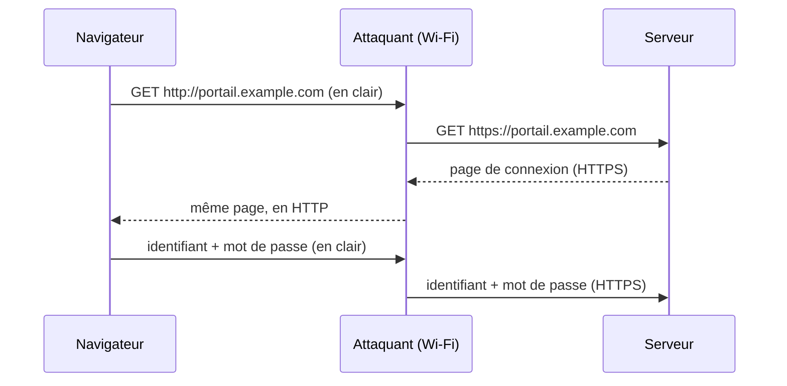
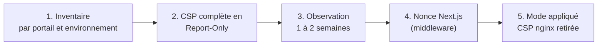

# HSTS et CSP : deux en-têtes, deux lignes, et tout ce qu'il faut savoir avant de les poser

*Un audit de sécurité finit presque toujours par la même ligne : « en-têtes HSTS et CSP absents ». La première se corrige en cinq minutes. La seconde peut casser une application en production si on la pose comme la première. Voici comment on a traité les deux sur une plateforme de santé (API FastAPI, deux portails Next.js, Keycloak, visio Jitsi, tableaux Grafana), derrière un frontal OpenResty.*

---

## 🔒 HSTS : « ce site, c'est HTTPS, point »

### Le problème : la première requête

Tout le monde redirige HTTP vers HTTPS. Mais quand un utilisateur tape `portail.example.com` dans sa barre d'adresse, le navigateur envoie d'abord une requête **en clair** sur le port 80, et c'est seulement la réponse (`301 → https://…`) qui l'emmène en HTTPS.

Sur un réseau non fiable (Wi-Fi d'hôpital, de gare, d'hôtel), un attaquant placé au milieu peut intercepter cette première requête et **ne jamais laisser passer la redirection** : il parle HTTPS au serveur et HTTP à la victime. C'est le *SSL stripping*.



Le cadenas manque, mais qui le regarde ?

### La parade

```nginx
add_header Strict-Transport-Security "max-age=31536000; includeSubDomains" always;
```

Une fois cet en-tête reçu, et pendant un an (`max-age` en secondes), le navigateur :

- **réécrit lui-même** tout `http://` en `https://` pour ce domaine, sans envoyer un seul octet en clair ;
- **refuse** un certificat invalide, sans bouton « continuer quand même » : un attaquant avec un faux certificat n'a plus de prise.

`includeSubDomains` étend la règle à tous les sous-domaines. `always` force nginx à poser l'en-tête aussi sur les réponses d'erreur (4xx, 5xx), qu'il oublie sinon.

### Les trois précautions

1. **La toute première visite reste exposée.** Le navigateur ne connaît la règle qu'après l'avoir reçue une fois. Seule la liste *preload*, intégrée aux navigateurs, couvre ce cas.
2. **`preload` est quasi irréversible.** Une fois le domaine inscrit, en sortir prend des mois (il faut attendre les versions des navigateurs). On ne l'a pas fait : le gain (la première visite) ne justifiait pas de figer ce choix.
3. **`includeSubDomains` engage tous les sous-domaines.** Un sous-domaine oublié sans certificat valide (une vieille interface d'administration, un service de recette) devient **inaccessible** pour tout navigateur qui a reçu l'en-tête. Chez nous, les certificats wildcard couvrent tout ; ailleurs, inventaire d'abord.

Corollaire : retirer l'en-tête ne sert à rien à court terme. Les navigateurs gardent la règle jusqu'à l'expiration du `max-age`. Si vous doutez, commencez par `max-age=300` et montez par paliers.

---

## 🧱 CSP : dire au navigateur ce que la page a le droit de faire

### Ce qu'une CSP apporte

La *Content-Security-Policy* liste les sources autorisées pour chaque type de ressource. Les deux directives qui comptent vraiment :

- **`script-src`** : seuls les scripts listés s'exécutent. Une faille XSS (un `<script>` injecté dans un nom de patient, un commentaire, un paramètre d'URL) ne fait plus rien.
- **`connect-src`** : la page ne peut parler qu'aux serveurs listés (`fetch`, WebSocket). Même si un script malveillant passe, il ne peut pas **exfiltrer** les données vers son serveur.

Sur une application qui affiche des données de santé, c'est la meilleure défense en profondeur contre le XSS. Mais c'est aussi l'en-tête le plus facile à rater.

### Pourquoi on n'a pas posé la CSP complète tout de suite

L'inventaire des sources de nos deux portails a donné :

| Type | Sources |
|---|---|
| Scripts tiers | cinq CDN publics, reCAPTCHA, Sentry, Umami |
| Iframes | Grafana, Jitsi (auto-hébergé et SaaS), YouTube |
| Connexions | API, Keycloak, WebSocket temps réel (Soketi), Sentry, analytics |
| Médias locaux | `data:` et `blob:` (webcam, photos, audio, PDF) |

Le tout **par région et par environnement** (deux pays × dev / recette / prod), plus `localhost` en développement. Une seule source oubliée et c'est une page blanche, la connexion Keycloak qui ne revient pas, ou une visio sans image.

Et il y a Next.js : il injecte des scripts inline (hydratation, données de page). Une CSP sans `'unsafe-inline'` exige un **nonce par requête**, généré dans un middleware et repris par Next.js dans ses balises. Mettre `'unsafe-inline'` à la place est simple, mais retire l'essentiel de la protection.

### Ce qu'on a appliqué : la CSP minimale, sans risque

```nginx
add_header Content-Security-Policy "object-src 'none'; base-uri 'self'; frame-ancestors 'self'" always;
```

Trois directives qui ne cassent rien et ferment trois portes :

| Directive | Ce qu'elle bloque |
|---|---|
| `object-src 'none'` | les plugins (`<object>`, `<embed>`), vieux vecteur d'exécution de code |
| `base-uri 'self'` | une balise `<base>` injectée qui redirigerait toutes les URL relatives (scripts compris) vers un autre domaine |
| `frame-ancestors 'self'` | l'intégration de la page en iframe par un site tiers (*clickjacking*) |

Sans `default-src`, tout le reste est autorisé : c'est voulu. On l'a posée directement en mode appliqué (pas en *Report-Only*) parce qu'aucune de nos pages n'utilise de plugin, de `<base>`, ou n'est intégrée ailleurs.

### Le cas des iframes : chaque service décide pour lui

`frame-ancestors` se pose sur **la page intégrée**, pas sur celle qui intègre. Nos portails intègrent Grafana et Jitsi : ce sont donc **leurs** vhosts qui portent la liste des domaines autorisés à les afficher.

```nginx
# vhost Grafana
add_header Content-Security-Policy "frame-ancestors 'self' https://*.example.com https://*.example.org" always;
```

Au passage, `frame-ancestors` remplace l'ancien `X-Frame-Options` : un navigateur moderne qui reçoit les deux ignore `X-Frame-Options`. Nos portails envoient `X-Frame-Options: DENY` (pour les vieux navigateurs) **et** `frame-ancestors 'self'` : c'est la CSP qui s'applique.

### Le piège du double en-tête

Si nginx pose une CSP et que l'application en pose une autre, le navigateur ne choisit pas : il applique **les deux**, c'est-à-dire leur **intersection**. Une source autorisée par l'application mais absente de la CSP nginx reste bloquée, et on cherche longtemps pourquoi.

Règle retenue : la CSP minimale vit dans nginx tant qu'elle est seule ; le jour où la CSP complète arrive avec ses nonces (forcément posée par l'application), **on retire celle de nginx dans le même déploiement**.

---

## 🗺️ Le plan pour la CSP complète



- **Report-Only d'abord** : `Content-Security-Policy-Report-Only` signale les violations dans la console (et à un endpoint de rapport) sans rien bloquer. C'est l'usage réel, pas les tests, qui révèle la source oubliée.
- **Rapatrier les CDN** : un script servi par un CDN public est une source de plus à autoriser, et un tiers de plus dans la chaîne de confiance. L'embarquer dans le build simplifie la CSP.
- **Maintenance permanente** : chaque nouveau service tiers devra être déclaré. À inscrire dans la check-list d'intégration, sinon la CSP casse la fonctionnalité le jour de sa mise en production.

Effort estimé : environ trois jours de travail, étalés sur deux semaines à cause de l'observation.

---

## 🧪 Vérifier

```bash
curl -sI https://portail.example.com/ | grep -iE 'strict-transport|content-security'
```

Dans le navigateur, une violation CSP apparaît en rouge dans la console :

```text
Refused to load the script 'https://cdn.example.net/lib.js' because it violates
the following Content Security Policy directive: "script-src 'self' 'nonce-…'".
```

Et pour HSTS, `chrome://net-internals/#hsts` indique si le domaine est mémorisé (et permet de l'oublier pendant les tests).

---

## 🎓 Leçons

1. **HSTS : tout de suite, mais sans `preload` par réflexe.** Le gain est immédiat ; l'irréversibilité de `preload` mérite une décision à part.
2. **`includeSubDomains` est un engagement sur tout le domaine** : inventaire des sous-domaines et des certificats avant de l'activer.
3. **Une CSP minimale vaut mieux qu'une CSP complète reportée indéfiniment** : `object-src`, `base-uri` et `frame-ancestors` ne cassent rien et se posent le jour même.
4. **La CSP complète est un projet, pas un en-tête** : inventaire, Report-Only, nonce, observation, puis seulement le mode appliqué.
5. **Un seul endroit pour la CSP** : deux en-têtes s'intersectent, ils ne s'additionnent pas.
6. **`frame-ancestors` se règle sur la page intégrée** : c'est Grafana et Jitsi qui disent qui peut les afficher, pas les portails.
